# TeamJoy Frontend Architecture Graph & Node Index

## 1. Graph Overview & Node Navigation
This graph indexes all architectural nodes, dependency graphs, and features in `hr_management_frontend`. Searches can reference node identifiers to minimize token consumption and traversal time.

```mermaid
graph TD
    App[Root: lib/main.dart] --> Core[Node: Core]
    App --> Router[Node: App Router]
    
    Router --> Auth[Feature: Auth]
    Router --> Home[Feature: Home / ESS]
    Router --> Dashboard[Feature: Dashboard]
    Router --> People[Feature: People Directory]
    Router --> Employees[Feature: Employees]
    Router --> Attendance[Feature: Attendance]
    Router --> Leaves[Feature: Leaves]
    Router --> Holidays[Feature: Holidays]
    Router --> Payroll[Feature: Payroll]
    Router --> Settings[Feature: Settings]
    Router --> Tambola[Feature: Tambola / Games]
    Router --> QueryBuilder[Feature: Query Builder & Reports]

    Core --> Theme[Core: Theme & Responsive Tokens]
    Core --> AuthStorage[Core: AuthStorage & Session State]
    Core --> Sockets[Core: WebSockets & Permissions]
    Core --> Drawer[Core: HrDrawer]
    Core --> Network[Core: Network & Error Boundary]
```

---

## 2. Architectural Nodes

### [Node: Core]
- **Storage & State:** [`lib/core/services/auth_storage.dart`](file:///d:/Projects/hr_management_frontend/lib/core/services/auth_storage.dart) (JWT, roles, permissions, `userName`, `managerName`, `permissionRevision`)
- **Theme & Responsiveness:** [`lib/core/theme/theme_manager.dart`](file:///d:/Projects/hr_management_frontend/lib/core/theme/theme_manager.dart), [`lib/core/theme/app_theme_config.dart`](file:///d:/Projects/hr_management_frontend/lib/core/theme/app_theme_config.dart)
- **Sockets & Realtime:** [`lib/core/services/permission_socket_service.dart`](file:///d:/Projects/hr_management_frontend/lib/core/services/permission_socket_service.dart), [`lib/core/services/stomp_service.dart`](file:///d:/Projects/hr_management_frontend/lib/core/services/stomp_service.dart)
- **Navigation Components:** [`lib/core/widgets/hr_drawer.dart`](file:///d:/Projects/hr_management_frontend/lib/core/widgets/hr_drawer.dart), [`lib/core/widgets/responsive_scaffold.dart`](file:///d:/Projects/hr_management_frontend/lib/core/widgets/responsive_scaffold.dart)
- **Networking:** [`lib/core/network/api_client.dart`](file:///d:/Projects/hr_management_frontend/lib/core/network/api_client.dart) (Centralized HTTP client with automatic JWT header injection, 401 interceptor & redirect, and automatic `Content-Type: application/json` enforcement on POST/PUT/PATCH)

### [Node: Auth] (`lib/features/auth/`)
- **Pages:** [`login_page.dart`](file:///d:/Projects/hr_management_frontend/lib/features/auth/presentation/pages/login_page.dart) (Smart email-first status detection, debounced 350ms verification, inline pending activation callout with 1-tap onboarding launcher, deactivation notice, and responsive zero-overflow layout).
- **Service & Data:** [`auth_api_service.dart`](file:///d:/Projects/hr_management_frontend/lib/features/auth/data/auth_api_service.dart)
  - `AccountStatus` model (`ACTIVE`, `PENDING_ACTIVATION`, `DEACTIVATED`, `NOT_FOUND`).
  - `AuthException` with structured `isPendingActivation`, `isDeactivated`, and `isBadCredentials` flags.
  - In-memory `_statusCache` map eliminating redundant network roundtrips for repeated email checks.
  - Automatic cache clearing on successful account activation (`clearStatusCache`).
- **Tests:**
  - [`login_page_smart_flow_test.dart`](file:///d:/Projects/hr_management_frontend/test/features/auth/login_page_smart_flow_test.dart) (Debounced status detection, in-memory caching, pending activation card, dialog launcher, deactivation badge).
  - [`auth_screens_test.dart`](file:///d:/Projects/hr_management_frontend/test/screens/auth_screens_test.dart) (Zero-overflow responsive audits from 320dp small phone to desktop).
- **State & Identity Lifecycle:**
  - *Email-First Identity Resolution*: `GET /api/auth/account-status?email=...` ($O(1)$ indexed lookup returning `PENDING_ACTIVATION`, `ACTIVE`, `DEACTIVATED`, or `NOT_FOUND`).
  - *Zero-Redundant Query Login Fast-Path*: `UserPrincipal` pre-populates authenticated claims directly in memory, saving 3 redundant DB roundtrips per login request.
  - *Lifecycle Enforcement*: `isActivated` flag + `accountStatus` (`PENDING_ACTIVATION`, `ACTIVE`, `DEACTIVATED`) on `users` table; automatic employee termination sync with notice period expiration (`relievingDate <= today`).
- **State:** Role inspection (`ROLE_EMPLOYEE`, `ROLE_MANAGER`, `ROLE_HR_ADMIN`, `ROLE_SUPER_ADMIN`)

### [Node: Home / ESS] (`lib/features/home/`)
- **Pages:** [`employee_home_page.dart`](file:///d:/Projects/hr_management_frontend/lib/features/home/presentation/pages/employee_home_page.dart)
- **Widgets:**
  - `_IsolatedSunClockWidget` (Self-contained 30-second timer; eliminates full-screen setState)
  - [`home_shimmer.dart`](file:///d:/Projects/hr_management_frontend/lib/features/home/presentation/widgets/home_shimmer.dart) (Skeleton loader)
- **Capabilities:** Live sun position, greeting, pending manager approvals badge, latest payslip snapshot, upcoming holidays.

### [Node: Dashboard] (`lib/features/dashboard/`)
- **Pages:** [`dashboard_page.dart`](file:///d:/Projects/hr_management_frontend/lib/features/dashboard/presentation/pages/dashboard_page.dart)
- **Widgets:** [`dashboard_skeleton.dart`](file:///d:/Projects/hr_management_frontend/lib/features/dashboard/presentation/widgets/dashboard_skeleton.dart)

### [Node: People & Directory] (`lib/features/people/`)
- **Pages:** [`people_page.dart`](file:///d:/Projects/hr_management_frontend/lib/features/people/presentation/pages/people_page.dart)
- **Capabilities:** Directory, Org Chart, Starred vs Everyone, Search, Filter.

### [Node: Employees] (`lib/features/employees/`)
- **Pages:** [`employee_profile_page.dart`](file:///d:/Projects/hr_management_frontend/lib/features/employees/presentation/pages/employee_profile_page.dart) (Profile details, attendance calendar, actions, `Send Onboarding Credentials` dialog title wrapped with `Expanded` to prevent mobile overflow)
- **Widgets:** [`employee_card.dart`](file:///d:/Projects/hr_management_frontend/lib/features/employees/presentation/widgets/employee_card.dart)
- **Lifecycle & Security:**
  - `relievingDate` tracking for notice period offboarding.
  - Automatic deactivation cascade on `TERMINATED` or notice period completion.
  - Guard against re-issuing onboarding activation keys to active employees.

### [Node: Attendance] (`lib/features/attendance/`)
- **Pages:** [`attendance_calendar_page.dart`](file:///d:/Projects/hr_management_frontend/lib/features/attendance/presentation/pages/attendance_calendar_page.dart)
- **Widgets:** [`attendance_calendar_skeleton.dart`](file:///d:/Projects/hr_management_frontend/lib/features/attendance/presentation/widgets/attendance_calendar_skeleton.dart)
- **Optimization:** $O(1)$ attendance record map lookup (`_attendanceByDate`) replacing linear list scans.

### [Node: Leaves] (`lib/features/leaves/`)
- **Pages:** [`leave_management_page.dart`](file:///d:/Projects/hr_management_frontend/lib/features/leaves/presentation/pages/leave_management_page.dart)
- **Widgets:** [`apply_leave_dialog.dart`](file:///d:/Projects/hr_management_frontend/lib/features/leaves/presentation/widgets/apply_leave_dialog.dart)
- **Capabilities:** Quotas balances, Team Approvals (Manager view with live Accept/Reject), Quota policies.

### [Node: Holidays] (`lib/features/holidays/`)
- **Pages:**
  - [`holiday_calendar_page.dart`](file:///d:/Projects/hr_management_frontend/lib/features/holidays/presentation/pages/holiday_calendar_page.dart) (Employee/Manager interactive holiday calendar with tabs for All, General, and Restricted holidays, RH quotas, and apply flow)
  - [`holiday_management_page.dart`](file:///d:/Projects/hr_management_frontend/lib/features/holidays/presentation/pages/holiday_management_page.dart) (Admin/HR holiday list master management: Create list, add holiday, toggle General/Restricted types, publish/unpublish lists, delete lists)
- **Widgets:** [`holiday_skeleton.dart`](file:///d:/Projects/hr_management_frontend/lib/features/holidays/presentation/widgets/holiday_skeleton.dart)
- **Capabilities:** Year selector, live holiday empty states, company holiday schedule, publish state synchronization.

### [Node: Payroll] (`lib/features/payroll/`)
- **Screens:**
  - [`payroll_processing_screen.dart`](file:///d:/Projects/hr_management_frontend/lib/features/payroll/presentation/screens/payroll_processing_screen.dart) (4-step batch wizard, pro-rata calculations, responsive compact steps on narrow mobile screens)
  - [`monthly_payroll_inputs_screen.dart`](file:///d:/Projects/hr_management_frontend/lib/features/payroll/presentation/screens/monthly_payroll_inputs_screen.dart) (Attendance sync, LOP adjustments, tax regime indicators)
  - [`salary_structure_screen.dart`](file:///d:/Projects/hr_management_frontend/lib/features/payroll/presentation/screens/salary_structure_screen.dart) (CTC master configurations, earnings & deductions)
  - [`payslip_screen.dart`](file:///d:/Projects/hr_management_frontend/lib/features/payroll/presentation/screens/payslip_screen.dart) (ESS payslips with styled fallback cards)

### [Node: Tambola / Games] (`lib/features/tambola/`)
- **Pages:** [`tambola_lobby_page.dart`](file:///d:/Projects/hr_management_frontend/lib/features/tambola/presentation/pages/tambola_lobby_page.dart)

### [Node: Query Builder & Reports] (`lib/features/query_builder/`)
- **Specification**: [`hr_query_builder_specification.md`](file:///d:/Projects/docs/hr_query_builder_specification.md)
- **State Management**: **Flutter Riverpod 2.x** (`queryMetadataProvider`, `queryBuilderNotifierProvider`, `queryCountProvider`, `queryPreviewProvider`, `queryTemplatesProvider` in [`query_builder_providers.dart`](file:///d:/Projects/hr_management_frontend/lib/features/query_builder/providers/query_builder_providers.dart))
  - *Debounce & Rate-Limiting*: 350ms async debounce on `QueryPreviewNotifier` and `queryCountProvider` preventing network request storms during rapid rule/filter toggling.
  - *Input Selection Preservation*: 300ms local timer and `TextSelection.collapsed` offset retention in `_RuleRow` eliminating cursor jumping and typing churn.
  - *Universal Boolean Scoping*: Safe nesting of Quick Filters under a top-level `AND` group when user AST utilizes `OR` conjunctions.
- **Data & API Layer**:
  - Models: [`query_metadata.dart`](file:///d:/Projects/hr_management_frontend/lib/features/query_builder/data/models/query_metadata.dart), [`query_ast.dart`](file:///d:/Projects/hr_management_frontend/lib/features/query_builder/data/models/query_ast.dart), [`query_template.dart`](file:///d:/Projects/hr_management_frontend/lib/features/query_builder/data/models/query_template.dart)
  - API Client: [`query_builder_api_client.dart`](file:///d:/Projects/hr_management_frontend/lib/features/query_builder/data/services/query_builder_api_client.dart)
- **Pages**:
  - [`query_builder_page.dart`](file:///d:/Projects/hr_management_frontend/lib/features/query_builder/presentation/pages/query_builder_page.dart) (Adaptive LayoutBuilder: 4-step wizard for mobile <650dp, two-column split for tablet, unified 3-column canvas for desktop)
- **Widgets**:
  - [`entity_selector_card.dart`](file:///d:/Projects/hr_management_frontend/lib/features/query_builder/presentation/widgets/entity_selector_card.dart) (Domain cards)
  - [`field_transfer_list.dart`](file:///d:/Projects/hr_management_frontend/lib/features/query_builder/presentation/widgets/field_transfer_list.dart) (Domain-scoped column selector with drag-and-drop reordering; primary entity prioritized followed by employee dimensions)
  - [`visual_rule_builder.dart`](file:///d:/Projects/hr_management_frontend/lib/features/query_builder/presentation/widgets/visual_rule_builder.dart) (Recursive AST filter rule card supporting AND/OR conjunctions, debounced text inputs, and compatible entity filtering)
  - [`quick_filter_bar.dart`](file:///d:/Projects/hr_management_frontend/lib/features/query_builder/presentation/widgets/quick_filter_bar.dart) (1-tap Department, Status, and conditional Month filter chips with opaque hit-testing)
  - [`kpi_metrics_banner.dart`](file:///d:/Projects/hr_management_frontend/lib/features/query_builder/presentation/widgets/kpi_metrics_banner.dart) (Live aggregate summary badges: Matched Records, Net Salary, Gross Earnings, LOP Days, Latency)
  - [`data_preview_table.dart`](file:///d:/Projects/hr_management_frontend/lib/features/query_builder/presentation/widgets/data_preview_table.dart) (Virtualized 2D table with corporate Navy styling `#1E293B`, sorting, and responsive pagination)
  - [`report_gallery_card.dart`](file:///d:/Projects/hr_management_frontend/lib/features/query_builder/presentation/widgets/report_gallery_card.dart) (Pre-built enterprise report cards with scale-down badges and zero-overflow button layouts)
  - [`template_management_dialog.dart`](file:///d:/Projects/hr_management_frontend/lib/features/query_builder/presentation/widgets/template_management_dialog.dart) (Reactive ConsumerStatefulWidget modal with inline saving & deletion spinners, empty placeholder, and live template management)
  - [`query_builder_skeleton.dart`](file:///d:/Projects/hr_management_frontend/lib/features/query_builder/presentation/widgets/query_builder_skeleton.dart) (`QueryShimmerBox` 1400ms pulse animations, `QueryPreviewSkeleton` with horizontally scrollable placeholder table, and `QueryBuilderPageSkeleton` for full-page catalog loading)
- **Loading, Placeholder & UX Hardening**:
  - *Non-destructive Data Refreshing*: Configured `skipLoadingOnReload: true` on `previewAsync.when(...)` paired with a sticky top `LinearProgressIndicator` (minHeight 2.5) and 0.65 `AnimatedOpacity` in `DataPreviewTable`. Scroll position and table structure are preserved while debounced queries execute in the background.
  - *Empty State Placeholders*: Added empty placeholder cards in `FieldTransferList` (guiding column selection) and `DataPreviewTable` (informing zero-record filter matches).
  - *Live Header Record Counter*: Added live pill badge in `QueryBuilderPage` top bar displaying debounced query count with real-time `Counting...` pulse.
- **Automated Responsive Test Suite**:
  - [`query_builder_responsive_test.dart`](file:///d:/Projects/hr_management_frontend/test/features/query_builder/query_builder_responsive_test.dart) (All 8 tests passing: TC-QB-01 through TC-QB-08, zero RenderFlex overflow verified on 320dp small-phone viewports under 1.0x to 2.0x font scaling)
- **UI Button Hardening**:
  - Replaced awkward Material 3 pill shape (`StadiumBorder`) with modern corporate rectangular buttons (`BorderRadius.circular(10)`).
  - Defined explicit `elevatedButtonTheme` and `outlinedButtonTheme` in [`theme.dart`](file:///d:/Projects/hr_management_frontend/lib/app/theme.dart) and [`theme_manager.dart`](file:///d:/Projects/hr_management_frontend/lib/core/theme/theme_manager.dart).
  - Integrated `_buildStepNavigation` with `Flexible` text and dedicated trailing/leading icons to guarantee arrows never wrap across multiple lines.
- **Export & Download Pipeline**:
  - Backend controller updated to return synchronous `ResponseEntity<byte[]>` with explicit `Content-Length` header, preventing HTTP chunked TCP connection drops during client download.
  - Cross-Platform `FileDownloader` (`file_downloader_stub.dart`): Integrates Android Storage Access Framework (SAF) via `FilePicker.platform.saveFile` on mobile devices with fallback to public `/storage/emulated/0/Download` directory and desktop `~/Downloads`, providing exact file path feedback in SnackBar notifications.
- **Navigation**:
  - Registered route `/query_builder` in [`router.dart`](file:///d:/Projects/hr_management_frontend/lib/app/router.dart)
  - Menu item "Report Builder" added to [`hr_drawer.dart`](file:///d:/Projects/hr_management_frontend/lib/core/widgets/hr_drawer.dart) for Super Admins, HR Admins, and Payroll Managers.

---

## 3. Automation, Performance & Quality Hardening

### [Node: Optimization Runbook & Automated Test Suite]
- **Runbook**: [`optimization_test_file.md`](file:///d:/Projects/hr_management_frontend/optimization_test_file.md) (TC-OPT-01 through TC-OPT-13)
- **Automated Test Coverage**: 32 test suites verifying 0 RenderFlex overflows across all viewports (including narrow 320x568 dp / 320 DPI) and 1.0x - 2.0x accessibility font scales.
- **Key Invariants Enforced**:
  - Isolated timers (`_IsolatedSunClockWidget` 30s shift ticker)
  - Zero-overflow wrapped rows and text clipping (`Flexible`, `FittedBox`)
  - Scroll-safe empty state columns (`SliverFillRemaining(hasScrollBody: false)`)
  - O(1) attendance date lookups and RepaintBoundaries on dynamic grids
