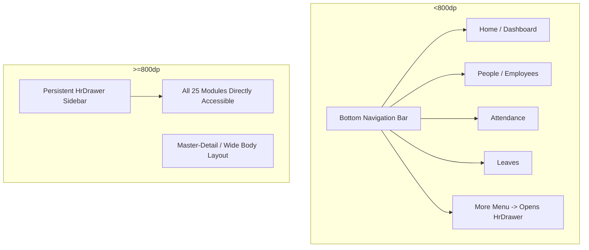

# Full Application Coverage & Shortest Navigation Path Graph
> **Document Purpose**: Production-grade traversal graph and deterministic minimal-step walkthrough to visually audit and verify 100% of screens, sub-views, and modal dialogs across **Small Phone (360x640 / 320 dpi)** and **Tablet (800x1280 / 1024x768)** form factors without redundant round trips.

---

## 1. Application Screen & Popup Index

### 1.1 Top-Level & Router Screens ([`lib/app/router.dart`](file:///d:/Projects/hr_management_frontend/lib/app/router.dart))
| Screen Identifier | Route | Access Level | Description | Key Mobile / Tablet Variations |
| :--- | :--- | :--- | :--- | :--- |
| **S01: Splash** | `/splash` | Public | Boot & auto-login check | Center logo, background gradient |
| **S02: Login** | `/login` | Public | Credentials, presets, mode toggle | Single col (phone) vs centered card (tablet) |
| **S03: Home (ESS)** | `/` | Employee / Manager | Clock in/out, shift card, quick actions | Sun clock + quick grid (single col vs 2-col) |
| **S04: Dashboard** | `/dashboard` or `/` | Admin / HR | KPI counts, approval stream, quick actions | 2-col KPI (phone) vs 4-col KPI + sidebar (tablet) |
| **S05: Employees Directory** | `/employees` | Admin / HR | Employee search, list cards, filters | Card list (phone) vs data grid (tablet) |
| **S06: Employee Profile** | `/employee_profile` | All (Self / Targeted) | Profile bio, docs, bank info, status | Tabbed view (bio, salary, attendance, leaves) |
| **S07: Employee Form (Add/Edit)** | `/employee_create`, `/employee_edit` | Admin / HR | Onboarding form, role assignment | Multi-step scroll form (safe keyboard insets) |
| **S08: People & Org Chart** | `/people` | All Authenticated | Colleague cards, search, org tree | Horizontal team chips & list cards |
| **S09: Attendance Calendar** | `/attendance` | All Authenticated | Monthly punch calendar, summary chips, Biometric Excel import | Month grid, punch timeline, Import Punch Excel button |
| **S10: Leaves Hub** | `/leaves` | All Authenticated | Balance cards, request table, approvals | Balance horizontal slider vs tablet grid |
| **S11: Holiday Calendar** | `/holidays` | All Authenticated | Public holiday list, calendar days | Colored badges, upcoming holiday highlights |
| **S12: Holiday Management** | `/holiday_management` | Admin / HR | Create, edit, delete calendar holidays | Inline add bar & management list |
| **S13: HR Leave Settings** | `/hr_leave_settings` | Admin / HR | Quota configuration, carryover rules | Policy list, entitlement editor |
| **S14: Leave Policy Handbook** | `/leave_policy` | All Authenticated | Company leave rules & terms handbook | Read-only markdown & card guidelines |
| **S15: Run Payroll** | `/payroll_process` | Admin / HR | Execute payroll calculations & review | Processing status, batch run trigger |
| **S16: Payroll Inputs & LOP** | `/payroll_inputs` | Admin / HR | Adjust days, deductions, bonuses | Editable inputs list with quick save |
| **S17: Salary Structures** | `/salary_structure` | Admin / HR | CTC breakdown, allowances, slabs | Breakdown preview card & sliders |
| **S18: Payslips Archive** | `/payslip` | All Authenticated | Personal or company-wide payslips | Monthly payslip cards with PDF download |
| **S19: Report Query Builder (Excel Export)** | `/query_builder` | Admin / HR | Filter workforce datasets, aggregate preview, **Export as Excel (.xlsx)** & CSV | Filter selector, dynamic preview table & Excel export popup menu |
| **S20: Game Zone** | `/games` | All Authenticated | Social game hub (Tambola, Draw & Guess) | Game launch cards with player counts |
| **S21: Tambola Lobby** | `/tambola` | All Authenticated | Game rooms, active games, create room | Room code input & lobby list |
| **S22: Tambola Room** | `/tambola_game` | All Authenticated | Real-time ticket, number board | Ticket matrix & real-time number board |
| **S23: Draw & Guess Lobby**| `/draw-and-guess` | All Authenticated | Multiplayer canvas game lobby | Join room code, host room button |
| **S24: Draw & Guess Room** | `/draw-and-guess/room` | All Authenticated | Live collaborative canvas & chat | Canvas drawing tools, chat guess feed |
| **S25: Settings** | `/settings` | All Authenticated | Theme mode, profile info, logout | Dark/Light toggle, theme palette selector |

---

### 1.2 Popups, Bottom Sheets & Modals Index
| Popup Identifier | Parent Screen / Trigger | Widget / Dialog Type | Actions / Inputs Verified |
| :--- | :--- | :--- | :--- |
| **D01: Account Activation** | `S02: Login` (Unactivated Email) | `showDialog` | 6-digit activation code, set new password |
| **D02: Forgot Password** | `S02: Login` | `showDialog` | Email prompt, OTP reset |
| **D03: Apply Leave Dialog** | `S10: Leaves` (`apply_leave_fab`) | `showDialog` (`ApplyLeaveDialog`) | Step 0 (Category), Step 1 (Type), Step 2 (Dates/Reason) |
| **D04: Leave Action / Withdraw** | `S10: Leaves` (Swipe / Tap card) | `showDialog` | Withdraw confirm or Reject comment prompt |
| **D05: Day Punch Detail Sheet** | `S09: Attendance` (Tap date) | `showModalBottomSheet` | Check-in / Check-out timestamps, hours, status |
| **D06: Regularize Attendance** | `S09: Attendance` (Tap missing day) | `showDialog` | Reason for missing punch, requested times |
| **D07: Add / Edit Holiday** | `S12: Holiday Management` | `showDialog` | Name, date picker, optional / mandatory switch |
| **D08: Onboard Credentials** | `S06: Profile` (Actions menu) | `showDialog` | Regenerate and copy onboarding link |
| **D09: Terminate / Demote Alert**| `S06: Profile` (Admin action) | `showDialog` | Relieving date, confirmation caution |
| **D10: Payslip Breakdown Sheet** | `S18: Payslips` (Tap payslip) | `showModalBottomSheet` / `showDialog` | Gross, deductions (PF, Tax), net pay summary |
| **D11: Host Tambola Room** | `S21: Tambola Lobby` | `showDialog` | Ticket count, game speed, create button |
| **D12: Color Picker Sheet** | `S24: Draw & Guess Room` | `showDialog` | Drawing palette selection |
| **D13: Theme Chooser Sheet** | `S25: Settings` | `showModalBottomSheet` | System / Light / Dark / Custom theme accents |
| **D14: Logout Confirmation** | `HrDrawer` or `S25: Settings` | `showDialog` | Confirm sign-out & return to `/login` |
| **D15: Biometric Excel Import** | `S09: Attendance` ('Import Punch Excel') | `showDialog` (`BiometricImportDialog`) | Pick `.xlsx` punch log, parse & sync progress, completion stats |

---

## 2. Navigation Topology & Device Differences



### Key Differences:
1. **Small Phone (<800dp)**: Primary 4 tabs (`Home`/`Dashboard`, `People`/`Employees`, `Attendance`, `Leaves`) via `BottomNavigationBar`. All other modules (Payroll, Games, Holidays, Settings, Query Builder) are accessed via `More` -> `HrDrawer`.
2. **Tablet (>=800dp)**: Persistent sidebar (`HrDrawer`) remains visible on the left; bottom navigation is completely hidden. All routes can be navigated in a single tap without closing drawers.

---

## 3. Shortest Full-Coverage Traversal Graph (Eulerian / DFS Walk)

To achieve **100% visual and functional coverage** of every screen and dialog with the minimum number of transitions, use this optimized deterministic path:

```
[Start S01: Splash] 
  │ 
  ▼
[S02: Login] ──(Trigger D01: Activation)──> ──(Trigger D02: Forgot Pwd)──>
  │  (Login as SuperAdmin: admin@company.com)
  ▼
[S04: Dashboard] ──(Tap approval row)──> (Verify Quick Leave Approval)
  │
  ├─► [S05: Employees Directory]
  │     ├─► [D08: Onboard Credentials Dialog]
  │     ├─► [S07: Employee Form - Create / Edit]
  │     └─► [S06: Employee Profile]
  │           └─► [D09: Terminate / Offboarding Dialog]
  │
  ├─► [S08: People & Org Chart]
  │
  ├─► [S09: Attendance Calendar]
  │     ├─► [D05: Day Punch BottomSheet]
  │     └─► [D06: Attendance Regularization Dialog]
  │
  ├─► [S10: Leaves Management]
  │     ├─► [D03: Apply Leave Dialog (Step 0 ➔ 1 ➔ 2)]
  │     └─► [D04: Withdraw / Cancel Dialog]
  │
  ├─► [S11: Holiday Calendar]
  │     └─► [S12: Holiday Management] ──► [D07: Add Holiday Dialog]
  │
  ├─► [S13: HR Leave Settings & Quotas]
  │
  ├─► [S14: Leave Policy Handbook]
  │
  ├─► [S15: Run Payroll] 
  │     ├─► [S16: Payroll Inputs & LOP]
  │     ├─► [S17: Salary Structures]
  │     └─► [S18: Payslips Archive] ──► [D10: Payslip Breakdown Sheet]
  │
  ├─► [S19: Report Query Builder]
  │
  ├─► [S20: Game Zone]
  │     ├─► [S21: Tambola Lobby] ──► [D11: Host Room] ──► [S22: Tambola Game Room]
  │     └─► [S23: Draw & Guess Lobby] ──► [S24: Draw & Guess Room] ──► [D12: Color Picker]
  │
  └─► [S25: Settings]
        ├─► [D13: Theme Chooser Sheet]
        └─► [D14: Logout Confirmation] ──► Return to [S02: Login]
              │
              ▼ (Login as Employee: lovish@company.com)
            [S03: Employee Home / ESS] (Verify Sun Clock & Punch In/Out)
```

---

## 4. Minimal Step Sequence by Numbers

### Phase 1: Authentication & Public Modals (Steps 1–4)
1. **S01 (`/splash`)**: App cold boot.
2. **S02 (`/login`)**:
   - Tap unactivated email test -> Open **D01 (Account Activation Dialog)** -> Close.
   - Tap Forgot Password -> Open **D02 (Forgot Password Dialog)** -> Close.
   - Tap preset `Admin (Full HR)` -> Tap `Sign In`.

### Phase 2: Core HR & People Management (Steps 5–11)
3. **S04 (`/dashboard`)**: Verify KPI cards, dynamic greeting, date pill.
4. **S05 (`/employees`)**: Verify employee grid/list cards.
5. **S07 (`/employee_create`)**: Open create employee form -> Verify field layout -> Back.
6. **S06 (`/employee_profile`)**: Tap employee profile:
   - Tap action menu -> Open **D08 (Onboarding Credentials Dialog)** -> Close.
   - Open **D09 (Terminate / Demote Alert)** -> Cancel.
7. **S08 (`/people`)**: Navigate to People directory -> Toggle org chart / directory tab.

### Phase 3: Attendance, Leaves & Holidays (Steps 12–19)
8. **S09 (`/attendance`)**:
   - Tap a past date cell -> Open **D05 (Day Punch Bottom Sheet)** -> Close.
   - Tap "Regularize" -> Open **D06 (Regularize Attendance Dialog)** -> Cancel.
9. **S10 (`/leaves`)**:
   - Tap FAB (`apply_leave_fab`) -> Open **D03 (Apply Leave Dialog)**:
     - Verify Step 0 (Category Picker).
     - Select category -> Verify Step 1 (Type Picker).
     - Select type -> Verify Step 2 (Date Picker & Reason Form).
     - Close dialog.
   - Tap existing leave request -> Open **D04 (Withdraw Dialog)** -> Cancel.
10. **S11 (`/holidays`)**: View holiday calendar.
11. **S12 (`/holiday_management`)**: Open holiday management -> Tap "+ Add Holiday" -> Open **D07 (Add Holiday Dialog)** -> Cancel.
12. **S13 (`/hr_leave_settings`)**: View quota policies and balance rules.
13. **S14 (`/leave_policy`)**: View policy handbook text.

### Phase 4: Payroll & Analytics Suite (Steps 20–25)
14. **S15 (`/payroll_process`)**: View payroll batch run status.
15. **S16 (`/payroll_inputs`)**: View employee LOP and allowance adjustments.
16. **S17 (`/salary_structure`)**: View CTC components and deduction rules.
17. **S18 (`/payslip`)**: View payslips -> Tap item -> Open **D10 (Payslip Detail Modal)** -> Close.
18. **S19 (`/query_builder`)**: View HR reporting canvas -> Select filters -> Tap Export button in AppBar -> Verify popup menu shows **`Export as Excel (.xlsx)`** and `Export as CSV (.csv)` -> Trigger test download.

### Phase 5: Game Zone & Multiplayer (Steps 26–31)
19. **S20 (`/games`)**: View Game Hub.
20. **S21 (`/tambola`)**: Tap Tambola -> Open **D11 (Host Room Dialog)** -> Cancel.
21. **S22 (`/tambola_game`)**: Navigate directly or join room -> Verify ticket grid -> Back.
22. **S23 (`/draw-and-guess`)**: Tap Draw & Guess lobby -> Host test game.
23. **S24 (`/draw-and-guess/room`)**: Enter room -> Open **D12 (Color Picker Dialog)** -> Close -> Back.

### Phase 6: Settings, Logout & Employee ESS (Steps 32–36)
24. **S25 (`/settings`)**:
   - Tap Theme -> Open **D13 (Theme Chooser Sheet)** -> Switch theme -> Revert.
   - Tap Logout -> Open **D14 (Logout Confirmation Dialog)** -> Confirm.
25. **S02 (`/login`)**: Select `Employee (Self-Service)` preset -> Tap `Sign In`.
26. **S03 (`/` or `/home`)**:
   - Verify `_IsolatedSunClockWidget` (geometry 66x66 dp, zero full rebuilds).
   - Verify shift timings & pending approvals card.

---

## 5. Verification Checkpoints for Phone vs Tablet

| Viewport | Test Parameter | Small Phone (360x640 / 320 dpi) | Tablet (800x1280 / 1024x768) |
| :--- | :--- | :--- | :--- |
| **Overflows** | `RenderFlex overflow` | Must be **0 errors** (all dialogs scrollable via `SingleChildScrollView`). | Must be **0 errors**. |
| **Navigation** | App Navigation Bar | `BottomNavigationBar` visible with 5 items. | `BottomNavigationBar` **hidden**; `HrDrawer` pinned on left. |
| **Dialog Width** | Modal Popups | Max width 90-95% screen width. | Centered modal bounded at `min(540dp, 80% width)`. |
| **Grids / Lists**| Card Layouts | Single-column or 2-column compact. | 3 to 4-column responsive adaptive grids. |
| **Top AppBars** | Title & Actions | Compact icons, ellipsis on long titles. | Expanded titles, inline action buttons with text labels. |
